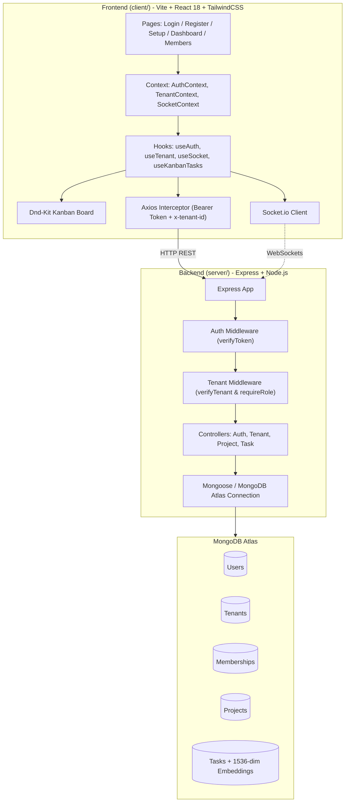

# CollabFlow AI

> **A Multi-Tenant SaaS Workspace & Real-Time Collaboration Platform**

CollabFlow AI is a modern, multi-tenant project management and collaboration platform built with a decoupled React SPA frontend and an Express/MongoDB Atlas backend. It features strict workspace data isolation, fine-grained role-based access control (RBAC), an interactive drag-and-drop Kanban board, and data schemas pre-configured for AI vector search.

---

## 📑 Table of Contents

- [Key Features](#-key-features)
- [System Architecture](#-system-architecture)
- [Tech Stack](#-tech-stack)
- [Project Structure](#-project-structure)
- [Multi-Tenancy & Security Model](#-multi-tenancy--security-model)
- [API Reference](#-api-reference)
- [Getting Started](#-getting-started)
  - [Prerequisites](#prerequisites)
  - [Backend Setup](#backend-setup)
  - [Frontend Setup](#frontend-setup)
- [Roadmap & Planned Features](#-roadmap--planned-features)

---

## ✨ Key Features

- **Strict Multi-Tenancy**: Organizations/Workspaces are completely isolated. A single user identity can belong to multiple workspaces with distinct roles.
- **Dynamic Role-Based Access Control (RBAC)**: Supports `owner`, `admin`, `member`, and `guest` roles. Permissions are validated dynamically on every request without requiring token re-issuance.
- **Interactive Drag-and-Drop Kanban Board**: Built with `@dnd-kit` featuring optimistic UI updates with automatic rollback on network failure.
- **Real-Time Collaboration Ready**: Client-side Socket.io infrastructure designed for workspace room management and instant task synchronization.
- **AI / Vector Search Ready**: Task schema includes 1536-dimensional vector embedding fields tailored for MongoDB Atlas Vector Search and OpenAI `text-embedding-3-small`.
- **Atomic Operations**: Workspace and owner membership creation are wrapped in MongoDB ACID transactions to prevent orphaned data.

---

## 🏛 System Architecture



---

## 🛠 Tech Stack

### Frontend
- **Framework**: [React 18](https://react.dev/) + [Vite 8](https://vitejs.dev/)
- **Styling**: [Tailwind CSS v4](https://tailwindcss.com/)
- **Routing**: [React Router DOM v6](https://reactrouter.com/)
- **Drag & Drop**: [@dnd-kit/core](https://dndkit.com/), `@dnd-kit/sortable`, `@dnd-kit/utilities`
- **HTTP Client**: [Axios](https://axios-http.com/)
- **Realtime**: [Socket.io Client](https://socket.io/)

### Backend
- **Runtime**: [Node.js](https://nodejs.org/) (CommonJS)
- **Framework**: [Express 4](https://expressjs.com/)
- **Database & ODM**: [MongoDB Atlas](https://www.mongodb.com/atlas) + [Mongoose 8](https://mongoosejs.com/)
- **Authentication**: [JSON Web Tokens (jsonwebtoken)](https://github.com/auth0/node-jsonwebtoken) + [bcrypt](https://github.com/kelektiv/node.bcrypt.js)
- **CORS & Environment**: `cors`, `dotenv`

---

## 📁 Project Structure

```text
collab_work/
├── client/                          # React + Vite Frontend
│   ├── index.html                   # HTML template
│   ├── vite.config.js               # Vite config with Tailwind CSS & React plugins
│   ├── package.json                 # Frontend dependencies & scripts
│   └── src/
│       ├── main.jsx                 # Application entry point
│       ├── App.jsx                  # Route definitions & Context providers
│       ├── index.css                # Global styles
│       ├── components/              # Shared UI & Kanban components
│       │   ├── AuthLayout.jsx       # Auth page wrapper
│       │   ├── Button.jsx           # Button with loading states
│       │   ├── FormField.jsx        # Styled form inputs
│       │   ├── FullPageSpinner.jsx  # Loader
│       │   ├── ProtectedRoutes.jsx  # Route guards (RequireAuth, RequireWorkspace, PublicOnly)
│       │   ├── CreateProjectForm.jsx# Inline project creator
│       │   └── kanban/              # Kanban board, columns, task cards, and constants
│       ├── context/                 # React Contexts (Auth, Tenant, Socket)
│       ├── hooks/                   # Custom Hooks (useAuth, useTenant, useSocket, useKanbanTasks)
│       ├── pages/                   # Views: Login, Register, WorkspaceSetup, Dashboard, Members
│       └── services/                # API Axios client & Socket factory
│
└── server/                          # Express + Node.js Backend
    ├── server.js                    # Server startup & middleware registration
    ├── package.json                 # Backend dependencies & scripts
    ├── .env.example                 # Backend environment variable template
    └── src/
        ├── config/                  # Database connection setup
        ├── controllers/             # Request handlers (auth, tenant, project, task)
        ├── middleware/              # Auth, tenant isolation, and centralized error handling
        ├── models/                  # Mongoose models (User, Tenant, Membership, Project, Task)
        ├── routes/                  # Express route declarations
        ├── sockets/                 # Real-time WebSocket handlers
        └── utils/                   # AppError and catchAsync helper utilities
```

---

## 🔒 Multi-Tenancy & Security Model

1. **Global Identities with Decoupled Memberships**:
   - The `User` model stores global credentials without tenant data.
   - The `Membership` model acts as the join entity between `User` and `Tenant`, managing roles (`owner`, `admin`, `member`, `guest`).
2. **Stateless JWT + Dynamic Database-Level Tenant Verification**:
   - The JWT token payload holds only `{ id, email }`. It does not store static tenant IDs or roles.
   - The client sends the selected tenant ID via the `x-tenant-id` header.
   - `verifyTenant` middleware validates on **every single request** that the user currently belongs to the requested workspace. Role changes or revocations apply immediately without needing to wait for token expiration.
3. **Query-Level Tenant Isolation**:
   - Controllers never trust a `tenantId` parameter from the client payload. All queries scope explicitly to `req.tenantId` assigned by the verified membership.
4. **Cross-Tenant Obfuscation**:
   - Resources queried with a valid ID belonging to another workspace return `404 Not Found` (rather than `403 Forbidden`), preventing ID enumeration attacks across workspaces.

---

## 📡 API Reference

### Authentication (`/api/auth`)
| Method | Endpoint | Access | Description |
| :--- | :--- | :--- | :--- |
| `POST` | `/api/auth/register` | Public | Create a new user account |
| `POST` | `/api/auth/login` | Public | Authenticate user and receive JWT |

### Workspaces & Tenants (`/api/tenants`)
| Method | Endpoint | Access | Description |
| :--- | :--- | :--- | :--- |
| `POST` | `/api/tenants` | Authenticated | Create a workspace (atomic creation with creator as `owner`) |
| `GET` | `/api/tenants/my-workspaces` | Authenticated | List all workspaces the authenticated user belongs to |

### Projects (`/api/projects`)
*Requires `x-tenant-id` header.*
| Method | Endpoint | Access / Role | Description |
| :--- | :--- | :--- | :--- |
| `GET` | `/api/projects` | Workspace Member | List all projects in the current workspace |
| `POST` | `/api/projects` | `owner`, `admin`, `member` | Create a new project in the workspace |
| `GET` | `/api/projects/:projectId/tasks` | Workspace Member | Fetch all tasks for a specific project |

### Tasks (`/api/tasks`)
*Requires `x-tenant-id` header.*
| Method | Endpoint | Access / Role | Description |
| :--- | :--- | :--- | :--- |
| `POST` | `/api/tasks` | `owner`, `admin`, `member` | Create a new task within a project |
| `PUT` | `/api/tasks/:id/status` | `owner`, `admin`, `member` | Update task status (`backlog`, `todo`, `in-progress`, `in-review`, `done`) |

---

## 🚀 Getting Started

### Prerequisites
- [Node.js](https://nodejs.org/) (v18.x or higher)
- [npm](https://www.npmjs.com/)
- [MongoDB Atlas](https://www.mongodb.com/atlas) cluster (or local MongoDB replica set for transaction support)

### Backend Setup

1. Navigate to the server directory:
   ```bash
   cd server
   ```
2. Install dependencies:
   ```bash
   npm install
   ```
3. Create an `.env` file based on `.env.example`:
   ```bash
   cp .env.example .env
   ```
4. Configure your `.env` variables:
   ```env
   PORT=5000
   NODE_ENV=development
   MONGO_URI="mongodb+srv://<username>:<password>@<cluster>.mongodb.net/<database>?retryWrites=true&w=majority"
   JWT_SECRET="your-jwt-secret-key"
   JWT_EXPIRES_IN="7d"
   ```
5. Start the backend server:
   ```bash
   # Development mode with nodemon
   npm run dev

   # Production mode
   npm start
   ```

### Frontend Setup

1. Open a new terminal and navigate to the client directory:
   ```bash
   cd client
   ```
2. Install dependencies:
   ```bash
   npm install
   ```
3. (Optional) Create a `.env` file for custom API endpoints:
   ```env
   VITE_API_URL="http://localhost:5000/api"
   ```
4. Start the Vite development server:
   ```bash
   npm run dev
   ```
5. Open your browser and navigate to `http://localhost:5173`.

---

## 🗺 Roadmap & Planned Features

- [ ] **Socket.io Server Integration**: Complete the backend event handlers in `server/src/sockets` for live Kanban board updates (`task:created`, `task:statusChanged`).
- [ ] **Workspace Member Management API**: Implement `GET`, `POST`, `PATCH`, and `DELETE` endpoints on `/api/tenants/members` to support the frontend Members management view.
- [ ] **MongoDB Atlas Vector Search**: Build out semantic search and AI automated task triage using the pre-configured `embedding` fields in the `Task` schema.
- [ ] **Activity & Audit Logging**: Track state changes and user activity per workspace.
